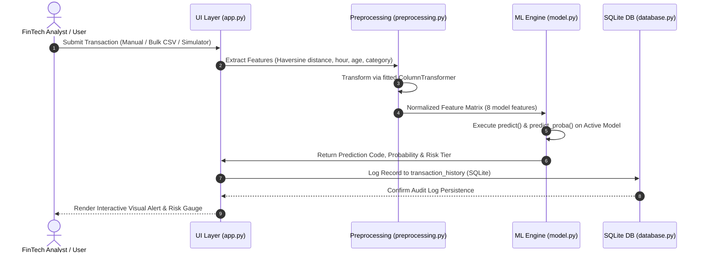

# Project Architecture: Real-Time Financial Fraud Detection System 🛡️

This document outlines the technical architecture, data flow, machine learning pipeline, persistence model, and decision engine powering the **Real-Time Financial Fraud Detection System**.

---

## 1. High-Level System Architecture

```mermaid
flowchart TD
    subgraph UI["Presentation Layer (Streamlit 4-Page Dashboard)"]
        P1["1. Dashboard (KPIs & Class Distribution)"]
        P2["2. Model Performance (Benchmark & PR/ROC Curves)"]
        P3["3. Transaction Prediction (Human-Readable Manual Input)"]
        P4["4. Live Monitoring (Bulk CSV & Continuous Stream Simulator)"]
    end

    subgraph Ingestion["Transaction Ingestion Engine"]
        M_IN["Manual Single Transaction Form"]
        B_IN["Bulk CSV Batch Ingestion"]
        S_IN["Live Stream Simulation Engine"]
    end

    subgraph Prep["Feature Engineering & Preprocessing Pipeline"]
        FE["Feature Extraction\n• Haversine Distance (km)\n• Hour, Day of Week, Is Weekend\n• Cardholder Age & City Pop"]
        CT["ColumnTransformer Pipeline\n• StandardScaler (Numerics)\n• OneHotEncoder (14 Categories)"]
    end

    subgraph MLEngine["Machine Learning & Benchmark Engine"]
        LR["Logistic Regression (Class-Weighted)"]
        RF["Random Forest (Balanced Subsample)"]
        XGB["XGBoost (scale_pos_weight)"]
        SWITCH["Dynamic Model Switcher\n(Zero-Downtime Session Switching)"]
    end

    subgraph Policy["Decision Policy & Risk Tiering"]
        PROB["Posterior Probability Score (0.00% - 100.0%)"]
        TIER["Risk Tiering Engine\n• Low Risk (< 30%): Auto-Authorize\n• Medium Risk (30-70%): Step-up 2FA\n• High Risk (> 70%): Instant Decline"]
    end

    subgraph Storage["Persistent Storage Layer (SQLite + Joblib)"]
        DB_TX["transaction_history (Audit Trail)"]
        DB_TR["training_history (Benchmark Logs)"]
        DB_REG["dataset_registry (Persistent Datasets)"]
        PKL["models/fraud_model.pkl (Candidate Bundle)"]
        BAK["models/fraud_model_backup.pkl (Safety Rollback)"]
    end

    UI --> Ingestion
    Ingestion --> Prep
    Prep --> MLEngine
    MLEngine --> Policy
    Policy --> Storage
    Storage --> UI
```



---

## 2. End-to-End Data Flow

The following sequence illustrates how incoming transaction data moves from ingestion to persistence:



---

## 3. Machine Learning Pipeline & Candidate Benchmarking

### 3.1 Model Architectures & Imbalance Handling
Financial fraud datasets typically exhibit acute positive class rarity (~0.5%–1.5% fraud rate). Naive models tend to predict 100% legitimate transactions, yielding high accuracy while detecting zero frauds. 

Our ML engine benchmarks three diverse algorithms with explicit class-weighting mechanisms:

1. **Logistic Regression (Linear Baseline):**
   - Applies balanced class weights:
     $$w_1 = \frac{N}{2 \times N_{\text{fraud}}}$$
   - Fast convergence, highly interpretable linear weights.

2. **Random Forest (Ensemble Bagging):**
   - 100 balanced sub-sampled decision trees (`class_weight='balanced'`).
   - Mitigates overfitting and models non-linear interactions across amount, distance, and time.

3. **XGBoost (Extreme Gradient Boosted Trees):**
   - Gradient boosted trees utilizing positive scale weighting:
     $$\text{scale\_pos\_weight} = \frac{N_{\text{legitimate}}}{N_{\text{fraud}}}$$
   - Optimizes logistic loss for hard-to-detect non-linear anomalies.

### 3.2 Evaluation Metrics
- **F1-Score:** Primary champion selection metric (harmonic mean of Precision and Recall).
- **PR-AUC (Precision-Recall Area Under Curve):** Evaluates true positive rates exclusively over the minority fraud class, preventing metric inflation from large negative counts.
- **ROC-AUC & Confusion Matrix:** Diagnostic validation of sensitivity vs. false positive rate.

---

## 4. Zero-Overhead Dynamic Model Switching

The system stores all candidate models inside the active serialized bundle:

```python
best_bundle = {
    "model": best_model,
    "pipeline": fitted_pipeline,
    "model_name": best_name,
    "candidate_models": {
        "Logistic Regression": model_lr,
        "Random Forest": model_rf,
        "XGBoost": model_xgb
    },
    "all_comparisons": comparison_results,
    "metrics": comparison_results[best_name]
}
```

### Switching Workflow:
- If multiple candidates are present, the sidebar surfaces an interactive selector:
  `Select Active Champion Model: [Logistic Regression | Random Forest | XGBoost]`.
- Switching calls `switch_active_model()`, updating `bundle["model"]` and `bundle["model_name"]` in session state.
- **Zero Retraining Required:** Subsequent manual predictions, bulk CSV runs, and continuous stream simulations immediately execute inference against the newly chosen algorithm.

---

## 5. Persistent Dataset Registry & Retraining Engine

To support operational machine learning workflows, uploaded datasets and training sets are persistently tracked in SQLite without requiring repeated re-uploading:

### Database Schema (`dataset_registry`):
| Column Name | SQLite Data Type | Description |
| :--- | :--- | :--- |
| `id` | INTEGER PRIMARY KEY | Unique dataset record ID |
| `filename` | TEXT NOT NULL | Dataset filename (e.g. `fraudTrain.csv`) |
| `filepath` | TEXT NOT NULL UNIQUE | Absolute disk location (`data/registered_datasets/`) |
| `upload_timestamp` | TIMESTAMP | Registration timestamp |
| `total_records` | INTEGER NOT NULL | Total transaction rows |
| `fraud_records` | INTEGER NOT NULL | Positive fraud class count |
| `legit_records` | INTEGER NOT NULL | Negative legitimate class count |
| `file_size_kb` | REAL | File size in kilobytes |
| `is_active` | INTEGER (0 or 1) | Active training dataset indicator |

### Retraining Workflow:
1. **Registered Dataset Execution:** The administrator clicks **"🚀 Retrain Model on Registered Dataset"** in the sidebar. The system reads the active dataset directly from disk.
2. **Safety Backup:** An atomic copy of `models/fraud_model.pkl` is saved to `models/fraud_model_backup.pkl`.
3. **Training & Benchmarking:** All three candidate algorithms are fitted on `X_train` and evaluated against `X_test`.
4. **Audit Logging:** Metric results and dataset parameters are committed to `training_history`.
5. **Rollback Protection:** If needed, the previous model can be restored with a single click.

---

## 6. Real-Time Ingestion Architecture

### Mode A: Bulk CSV Batch Processing
- Ingests multiple records in a single CSV file.
- Validates schema against required features (`amt`, `category`, `trans_date_trans_time`, etc.).
- Executes vectorized feature transformation and batch inference.
- Performs high-performance bulk insertion (`cursor.executemany`) into `transaction_history`.
- Generates downloadable prediction results with assigned risk tiers.

### Mode B: Continuous Live Stream Simulator
- Generates realistic incoming synthetic transaction events.
- Configurable stream parameters:
  - **Volume:** 5 to 100 transactions per run.
  - **Pacing Delay:** 0.05s to 1.5s interval delay.
  - **Scenario Profiles:** Typical Consumer (~1.5% fraud), High-Risk Anomaly Surge (~25% fraud), Balanced Test (~10% fraud).
- Real-time animated progress bar with immediate alert badges for flagged anomalies.

---

## 7. SQLite Audit Logging & Analytics

All transactions across all three ingestion modes are audited in `data/monitoring.db` (`transaction_history`):

```sql
CREATE TABLE transaction_history (
    id INTEGER PRIMARY KEY AUTOINCREMENT,
    transaction_id TEXT UNIQUE NOT NULL,
    timestamp TEXT NOT NULL,
    amount REAL NOT NULL,
    category TEXT NOT NULL,
    distance_km REAL NOT NULL,
    city_pop INTEGER NOT NULL,
    hour INTEGER NOT NULL,
    day_of_week INTEGER NOT NULL,
    is_weekend INTEGER NOT NULL,
    age INTEGER NOT NULL,
    prediction TEXT NOT NULL,
    fraud_probability REAL NOT NULL,
    risk_category TEXT NOT NULL,
    source TEXT DEFAULT 'Manual Input',
    created_at TIMESTAMP DEFAULT CURRENT_TIMESTAMP
);
```

The unified monitoring dashboard provides:
1. **Interactive KPI Metrics:** Lifetime count, flagged frauds, legitimate approvals, high-risk alerts, average risk.
2. **Visual Analytics Grid:**
   - Outcomes & Risk Tiers bar chart
   - Cumulative transaction flow over time
   - Fraud probability distribution histogram
   - Ingestion source breakdown donut chart
3. **Audit Trail Filtering:** Live filtering by Prediction (`FRAUDULENT` / `LEGITIMATE`), Risk Tier (`Low`, `Medium`, `High`), Ingestion Source, and Search Query.
4. **CSV Export:** One-click export of filtered audit logs.
